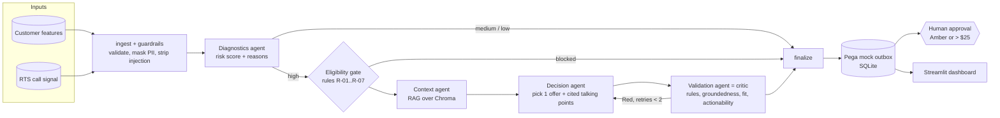

# Retention Agent — XYZ Telecom (Value Prepaid)

A multi-agent system that, every day at 5 AM, finds prepaid customers likely to churn, works out *why*, and recommends **one grounded, rule-compliant retention offer** with talking points for the care agent. Built with **LangGraph + Chroma (local RAG) + OpenAI + Streamlit** on **100% synthetic data** ("XYZ Telecom" is a fictional proxy).

It follows the course design pattern: *one role = one job = one output contract; validated handoffs; RAG grounds every output; a critic/quality gate; ≥2 evaluation methods plus a golden set; guardrails; operationalised from day one; a measurable improvement loop.*

## Architecture



| Agent | Job | Output contract | Model |
|---|---|---|---|
| Diagnostics | who is at risk and why | `DiagnosticsOutput` | code (+ small LLM only to break close ties) |
| Context | retrieve grounding (RAG) | `ContextBundle` with citations | embeddings only |
| Decision | choose 1 offer, write talking points | `DecisionOutput` | large LLM + small LLM reflection; deterministic fallback |
| Validation | grade and gate | `ValidationReport` (badge) | code rules + small LLM judge |
| Orchestrator | route, retry (cap 2), gate, audit | LangGraph `StateGraph` | none |

**Where RAG is used** (three Chroma collections, local embeddings, cosine):
- `offers` — semantic ranking of catalog offers for the customer's problem (hard eligibility is a *structured* pre-filter, not the LLM's job)
- `transcripts` — similar past calls, metadata-filtered by diagnosed reason, giving "what was accepted" evidence (60 calls, 2 chunks each)
- `policies` — playbook guidance for the reason + the most relevant rules (21 rules, 12 playbook chunks)

Every claim must carry a `[offer:ID]`, `[call:ID]`, `[playbook:ID]` or `[rule:ID]` citation that exists in the retrieved context. Numbers in the output must trace to the offer, the customer's data or retrieved text.

**Badges:** 🟢 Green = rules pass, groundedness ≥ 0.75, fit ≥ 4, actionability ≥ 4, overall ≥ 4.0 → ready. 🟠 Amber → human review. 🔴 Red (any hard rule failure, ≥ 2 weak dimensions, or overall < 3) → retry with feedback up to 2 times, then escalate to a human. Offers above **$25** always need approval, with an under-limit fallback offer shown.

## Quick start (VS Code)

```bash
python -m venv .venv && source .venv/bin/activate        # Windows: .venv\Scripts\activate
pip install -e ".[dev]"
cp .env.example .env                                      # add OPENAI_API_KEY to use real LLMs (optional)

python -m retention_agent demo                            # generate data, index Chroma, daily run, baseline vs tuned eval
python -m retention_agent dashboard                       # open the Streamlit dashboard
pytest                                                    # 28 tests, fully offline
```

Two modes, same code:
- **mock** (no key): deterministic Decision + heuristic judge. Runs offline; used by CI.
- **openai** (`OPENAI_API_KEY` set): large model decides, small model reflects/judges. Models via `OPENAI_MODEL_LARGE` / `OPENAI_MODEL_SMALL`.

Embeddings: default `EMBEDDING_BACKEND=onnx` (Chroma's MiniLM-L6-v2, free, downloads ~80 MB once). If you are offline use `EMBEDDING_BACKEND=hashing`.

## Commands

| Command | What it does |
|---|---|
| `python -m retention_agent generate [--customers 500 --seed 42]` | synthetic customers, RTS signals, offers, rules, transcripts, playbooks, golden set |
| `python -m retention_agent index` | rebuild the Chroma index |
| `python -m retention_agent run [--as-of 2026-10-25] [--limit N]` | the daily job; writes to the Pega outbox (supersedes yesterday's open items, expires after 24h) |
| `python -m retention_agent explain C9007` | run one customer and print every agent step |
| `python -m retention_agent eval --label tuned [--set KEY=VAL ...]` | evaluation harness |
| `python -m retention_agent search "dropped calls" --collection transcripts` | poke the vector DB |
| `python -m retention_agent dashboard` | Streamlit UI |

Any setting can be overridden: `--set RISK_THRESHOLD=0.5 APPROVAL_LIMIT_USD=40`.

## Dashboard
Overview funnel and badge mix · Recommendations with full detail, validation scores and clickable RAG sources · **Approvals queue** (approve/reject writes to the Pega outbox) · Agent observability (latency, tokens, cost, guardrail flags, retries, run history) · Evaluation (compare any two eval runs, golden cases, guardrail tests) · RAG explorer · **Customer lab** (run the agents live on one customer).

## Evaluation and the improvement loop
`eval` uses six independent methods: golden set (expected reason/offers/blocks computed from the rules engine, not from the agent) · rules-as-oracle (first-pass and final compliance) · heuristic and LLM-as-judge (agreement reported) · guardrail tests (injection, PII, fake citation, hallucinated number, disparagement, approval gate, retry cap) · Diagnostics AUC / precision / recall against hidden synthetic churn labels · latency, cost, retry and escalation rates.

The demo shows the loop: **baseline** (`USE_REASON_FILTER=false PREFILTER_ELIGIBILITY=false`) vs **tuned**. In baseline the critic catches bad picks (first-pass compliance ≈ 0.82, retries, escalations); tuned brings first-pass compliance to 1.0. Change one thing, re-run `eval`, compare in the dashboard.

## Guardrails (all deterministic, in `guardrails.py` / `rules.py`)
Schema validation of every input and handoff · PII masking and prompt-injection stripping on the RTS call text · eligibility gate (holdout, consent, fraud, open ticket, AQI, retry cap) · offer eligibility (plan, tenure, region, cost vs ARPU, no repeat) · citation and number tracing · no competitor disparagement or unauthorised promises · customer ids hashed in logs · fail closed: anything that cannot be made compliant goes to a human, never to a customer.

## Repo layout
```
retention_agent/   config, schemas (contracts), data_gen, rag (Chroma), rules, guardrails, llm, graph (LangGraph), run_daily, db, cli
  agents/          diagnostics, context, decision, validation
  evaluation/      golden, evaluate
dashboard/app.py   Streamlit
tests/             28 tests (rules, RAG, pipeline, Pega lifecycle, LLM paths via stub, eval, dashboard)
.github/workflows  CI: pytest in mock mode
```

## Push to GitHub
```bash
git init && git add . && git commit -m "Retention agent: LangGraph + Chroma + Streamlit"
git branch -M main && git remote add origin <your-repo-url> && git push -u origin main
```
`.env`, `data/` and `outputs/` are git-ignored; anyone can rebuild them with `python -m retention_agent demo`.

## Making it real (what is mocked)
- **Customer features / RTS signals** → replace `DataStore` with your warehouse and RTS feed (the pydantic contracts stay).
- **Pega** → `db.save_recommendation` is the outbox; swap for the Pega API client and keep the 24h expiry and supersession behaviour.
- **Scheduler** → run `python -m retention_agent run` from cron/Airflow at 05:00.
- **Durable state** → `Pipeline(..., checkpointer=SqliteSaver/PostgresSaver)` (default is in-memory).
- **Risk model** → Diagnostics uses a transparent scoring function; swap in your churn model behind the same `DiagnosticsOutput`.
- **Sizing/cost** → only high-risk, eligible customers (~15–25%) reach the LLM; everything else is code.

## Known limitations
Synthetic data is cleaner than reality; the risk model is hand-built (AUC ≈ 0.86 on synthetic labels); the OpenAI path is covered by stub tests but needs your key for a live check; token prices in `llm.py` are approximate.
